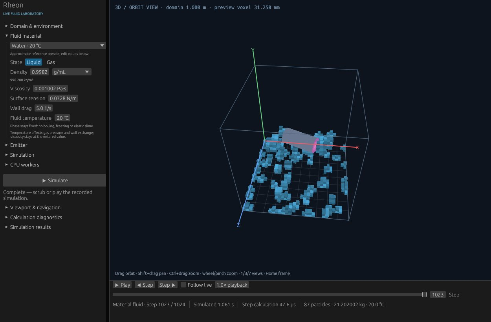

# Rheon

A general 3D fluid-physics solver in development. Rheon is intended to generate simulation datasets for training faster AI solvers, with a native laboratory for inspecting simulation states and comparing outcomes.

The current Rust implementation provides reusable numerical components, a desktop viewer and headless experiments. Solver development and the separate [surrogate-model lab](https://github.com/MrScripty/rheon-surrogate-lab) inform that larger goal.



## Run the desktop

Install Rust through rustup; the repository selects Rust 1.92.0. From the repository root, with a working desktop graphics environment:

```sh
cargo run --locked --release --features desktop --bin rheon-desktop
```

Choose a scene and select **Simulate**. Orbit with left/middle drag, pan with Shift+drag, and zoom with Ctrl+drag or the wheel. Scrub accepted steps while calculation continues.

The desktop includes material controls, particle inspection, bounded obstacle and transport labs, and VTK export. See the [desktop guide](src/bin/desktop/README.md).

For a headless smoke run with PNG guidance output:

```sh
cargo run --locked --release --bin rheon -- --output rheon-demo
```

Use a new output directory. [Solver selection and threading](docs/COMPARISON.md) cover Jacobi/SGS comparisons and parallel runs.

## Explore the implementation

- Fixed-box carrier simulation with two pressure implementations
- Liquid/gas particle preview with physical units and static-mesh collision
- Conservative liquid-volume transport, forces and separately scoped boundary/obstacle operators
- A reusable Rust library, research book and worked examples

These components have different physical scopes. The particle preview is approximate; general coupled 3D flow, calibrated boundaries and broader physical validation remain development work.

## Documentation

[Examples](examples/) · [Material model](docs/material-fluids.md) · [Collision meshes](docs/collision-meshes.md) · [Research book](docs/research-book/README.md) · [Roadmap](docs/research-book/implementation/requirements-roadmap.md) · [Implementation reference](docs/implementation-reference.md) · [Screenshot details](docs/native-app-review/material-preview-a552d0a/README.md)

Licensed under [Apache-2.0](LICENSE).

