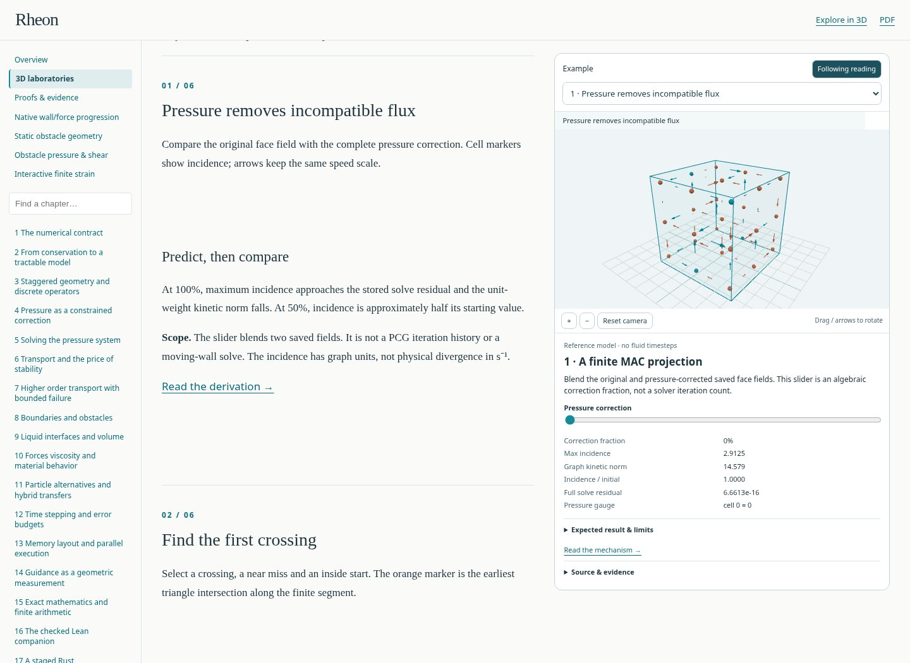
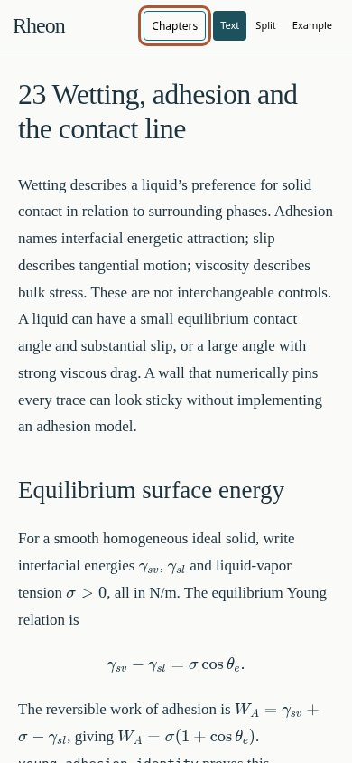
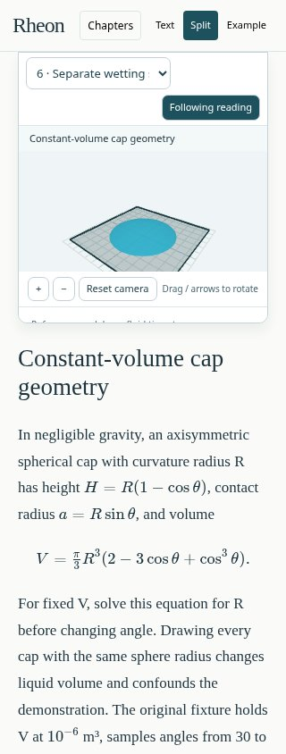
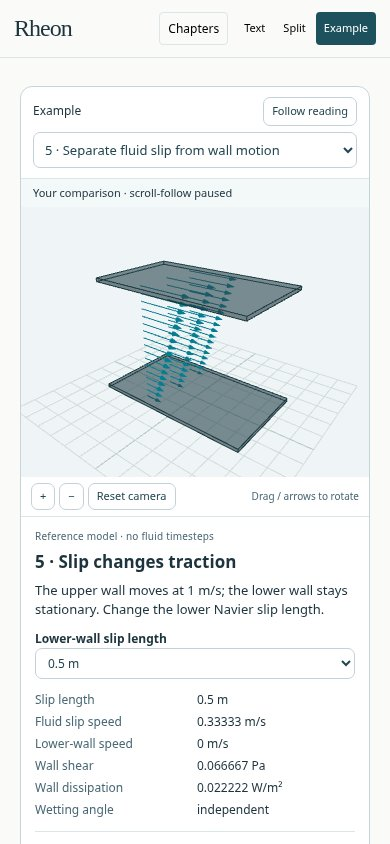

# Research-book layout captures

These are unaltered browser captures of the reviewed teaching edition at
[`540bdef8fcbc0d0a55567325eba570589666bf80`](https://github.com/MrScripty/Rheon/commit/540bdef8fcbc0d0a55567325eba570589666bf80).
They show the six-reference-lesson checkpoint before the subsequent transport
lessons. The user explicitly requested repository-hosted screenshots; these
four documentation images are a narrow exception to the normal external-only
generated-output policy. Numerical data, PDFs and disposable test output remain
external. The native-app captures in PR42 are separate and unchanged.

The browser was Chromium 151.0.7922.173 with software WebGL. Phone views are
browser emulation, not physical-device captures. Pixel sizes and SHA256 hashes
are in [the provenance record](research-book-540bdef/provenance.json).

## Desktop: chapters, reading, and a sticky example

## Phone: full-width text

## Phone: compact split view

## Phone: complete example controls

