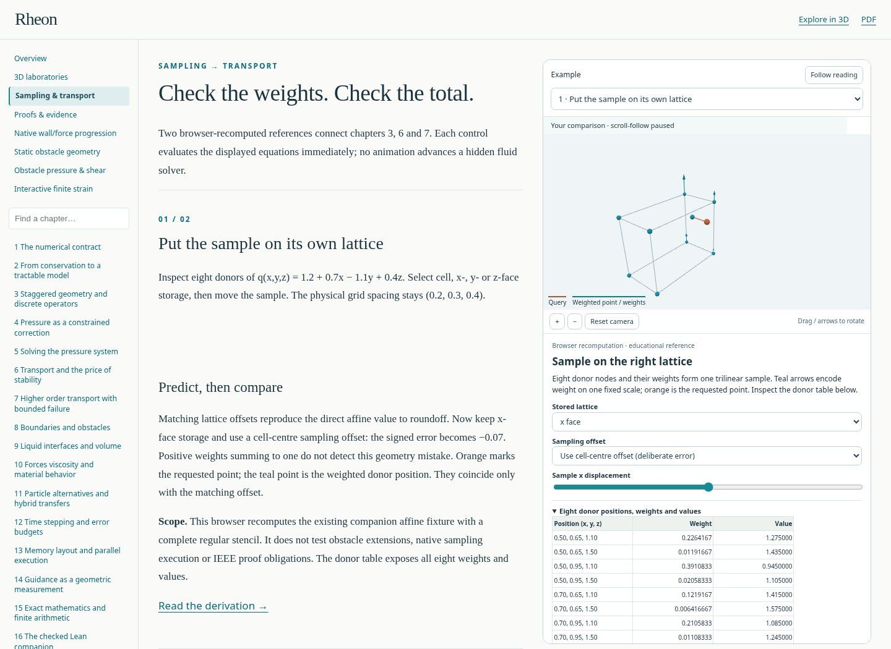
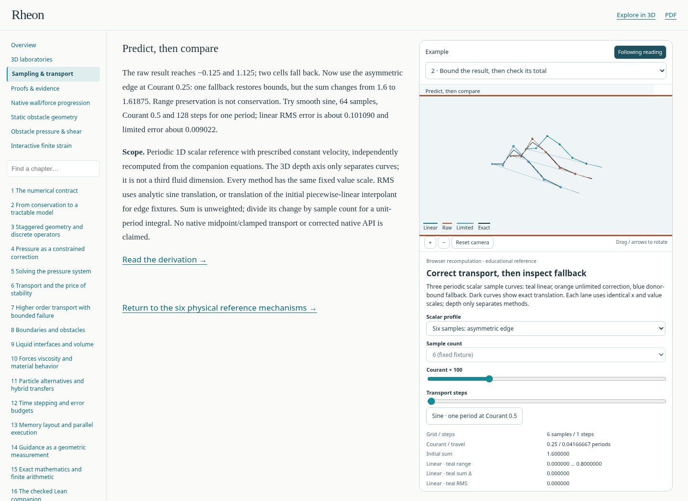
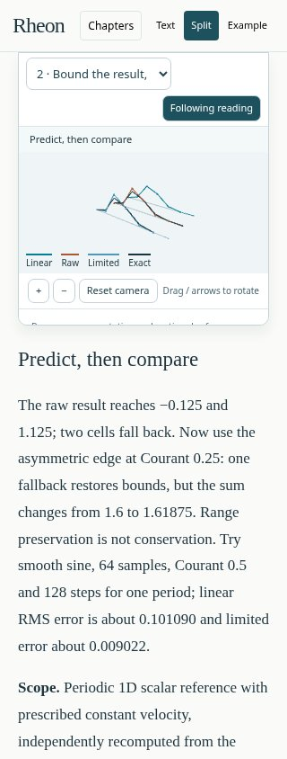
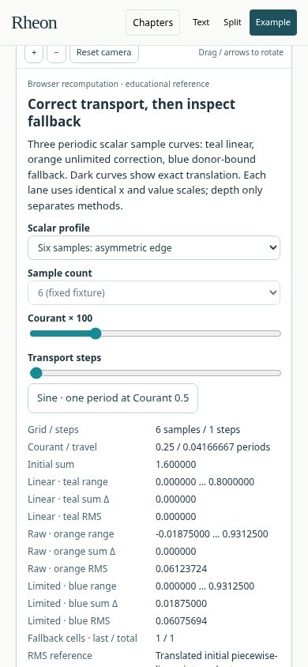

# Research-book layout captures

These unaltered browser captures document the current sampling/transport
lessons and the earlier six-reference checkpoint separately. The user explicitly
requested repository-hosted screenshots; these eight documentation images are
a narrow exception to the normal external-only generated-output policy.
Numerical data, PDFs and disposable test output remain external. The native-app
captures in PR42 are separate and unchanged.

Both sets use Chromium 151.0.7922.173 with software WebGL. Phone views are
browser emulation, not physical-device captures. All images retain their
original JPEG quality 85 bytes, with no cropping, resizing or other edits.

## Current sampling and transport lessons

These four captures came from clean local source commit
`ae06472f96d568d2f7077561e7b0080763510366`, tree
`4f96d068eb780fa22b6eca2481504596d8db75c0`. This source tree is byte-identical to
the published implementation
[`1c14e5787420b4db305abed96863e15535ca8e21`](https://github.com/MrScripty/Rheon/commit/1c14e5787420b4db305abed96863e15535ca8e21).
GitHub App publication changed commit metadata only. The
[current provenance record](research-book-transport/provenance.json) retains
the actual capture identity, pixel sizes and file hashes.

### Desktop: inspect the sample and its eight donors

### Desktop: compare transport beside the explanation

### Phone: compact split view at 320 pixels

### Phone: controls and measured results at 390 pixels

## Historical six-reference checkpoint

These four captures preserve the reviewed teaching edition at
[`540bdef8fcbc0d0a55567325eba570589666bf80`](https://github.com/MrScripty/Rheon/commit/540bdef8fcbc0d0a55567325eba570589666bf80).
They show the six-reference-lesson checkpoint before the subsequent transport
lessons. Pixel sizes and SHA256 hashes remain in
[the historical provenance record](research-book-540bdef/provenance.json).

### Desktop: chapters, reading, and a sticky example

### Phone: full-width text

### Phone: compact split view

### Phone: complete example controls

